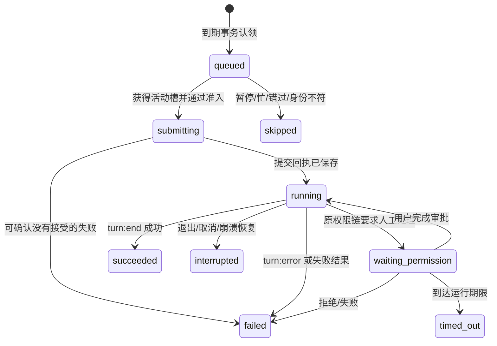

# 智开自动化任务执行方案

版本：1.0 · 2026-11-18 · 状态：待实施，本文不是已上线说明。

基线：`C:\Users\yyzxc\Desktop\Client-Platform\imagegen-client`，`feat/upgrade-1118@59cb3eeb7d5da1262a1ba7dd9f908143d42436aa`。实施前必须重新核对 HEAD 和脏文件。

文档结束复核时HEAD未变，但主工作区除原品牌构建资产外还出现inline-preview与static-html等未提交预览修改；本轮未触碰这些源码。实施必须先核对它们的归属和最终提交，不能把本文基线理解为主工作区现在无未提交改动。

配套：[分步执行手册](02-自动化任务分步执行手册.md)。两份文档合用；如参考截图与本文冲突，以用户要求及本文明确决策为准。截图中的文案、任务内容是示例数据，不是需要执行的指令。

## 1. 本轮目标和已经确认的边界

在现有智开客户端增加本机定时执行任务，支持创建、修改、暂停、恢复、运行记录、关联会话和关闭主窗口后的后台运行。交互参考 DSH，视觉沿用智开的白底、蓝紫强调色和公共组件。

用户已确认：**关闭主窗口后后台运行；选择“退出”后停止。** Windows 通知区域（系统托盘，包含折叠隐藏图标区）保留与客户端一致的品牌图标；右键可以打开客户端或退出。有已开启或正在运行的任务时，真正退出前必须提示“退出后自动化任务将无法执行”。不承诺进程退出后执行、关机时执行、开机自启或唤醒计算机。

本轮主要发布与真机验收平台为 Windows / WebView2。调度、持久化、协议和页面保持跨平台；macOS、Linux、麒麟的既有关闭行为不得被误改成没有托盘入口的隐藏。未实现托盘的平台在页面明确提示“关闭客户端后任务停止”，不宣称后台驻留已支持。

| 编号 | 必须交付的行为 | 实现位置 |
|---|---|---|
| R01 | “市场”正下方新增“更多”；四宫格加号风格图标；菜单首项“自动化任务” | 侧栏、全局管理窗口 |
| R02 | 管理窗口有已开启、已暂停、已结束、全部、搜索、列表和创建入口 | 自动化页面 |
| R03 | 新建任务包含名称、内容、执行位置、工作区、运行时间、时区 | 创建抽屉 |
| R04 | 工作区历史＋搜索＋底部“浏览其他目录...”调用本机目录选择器 | 工作区选择器 |
| R05 | 运行时间只有七种模式，不显示“自定义”、cron 或高级表达式输入 | 表单和后端校验 |
| R06 | 暂停移到已暂停；恢复重新计算未来执行时刻 | 服务、任务列表 |
| R07 | 自动任务会话带时钟，重启、历史恢复和跨工作区跳转后仍正确 | 会话来源映射 |
| R08 | 自动执行步骤复用 ExecutionCard＋ToolDetail，真实工具继续原展示 | 对话投影 |
| R09 | 关闭主窗保留托盘和后台调度，恢复主窗可继续查看原会话 | Windows 宿主 |
| R10 | 托盘退出有任务时先确认；取消后调度不变；确认后有界退出 | 退出协调器 |

保存新任务仅创建计划，**不隐式执行一轮**。本轮不注册让模型自行创建／修改定时任务的工具，不更改 agentloop Core，不扩展生图画板或代码图片预览功能。

## 2. 当前代码事实与改动原则

以下均已在上述主工作区检查。表内路径相对于仓库根，均为现有文件；新增文件见手册。

| 代码入口 | 当前事实及实施约束 |
|---|---|
| `cmd/runcode-desktop/frontend/src/shell/sidebar.tsx`、`App.tsx` | 顶部导航为对话／插件／市场；市场是独立页面。更多应是菜单入口，不重构已有导航 |
| `frontend/src/ui/README.md`（下文 frontend 均指 `cmd/runcode-desktop/frontend`） | 必须复用 token、Popover、按钮、表单与反馈组件；App 仅装配，业务状态进 session hook |
| `frontend/src/chat/execution-card.tsx`、`tool-detail.tsx`、`tool-text.ts`、`blocks.ts` | 已有工具折叠行、运行态、结果和展开详情。自动化步骤用适配器，不复制整套 JSX |
| `internal/desktop/multisession.go`、`sessions.go` | `OpenSession` 会聚焦、写当前工作区和 MRU；调度不能直接调用它 |
| `internal/desktop/app.go`、`questions.go` | `buildSessionModeHeld(..., focus=false, ...)` 已支持不抢焦点；`SubmitQuestion` 可返回持久 questionId |
| `internal/desktop/app.go` 的 `hostSinkAdapter.Emit` | 能观察 turn:end／turn:error，且在 host 每会话发射锁内；不得在此写 SQLite 或等待会话关闭 |
| `internal/protocol`、`tools/protogen` | 外壳 DTO 和命令在此定义，生成 TS；不是 `pkg/protocol`，不手改生成文件 |
| `internal/desktop/store.go` | `desktop.json` 有 configMu＋原子替换；历史工作区 MRU 最多 8 个 |
| `internal/desktop/sessions.go`、`main.go` | 原生 PickWorkspaceFolder 已可复用，取消返回空；选目录不等于切换会话 |
| `cmd/runcode-desktop/main.go` | Wails v3 `v3.0.0-beta.9`，主窗 WindowClosing 当前直接 Quit；隐藏录音窗预创建 |
| `frontend/src/shell/title-bar.tsx` | 关闭按钮直接 `Application.Quit()`；必须和 native close 一起改 |
| `internal/desktop/exit.go` | `PrepareExit(20s)` 一次性不可撤销，关闭全部会话；隐藏主窗不能调用它 |
| `internal/localusage`、根 `go.mod` | 已有 modernc SQLite；自动化建立独立数据库，复用 driver，不混入用量库 |
| `brand.go`、`scripts/build-desktop.sh` | 品牌、单实例、图标和 build-info 随品牌构建；托盘不得写死 DSH 或 XRUN 图标 |

改动以功能边界组织：新增独立 `internal/automation` 承担调度与存储；desktop 只适配现有会话、身份和权限；前端只展示状态。保留现有会话／图片预览／录音／更新功能，避免把自动化计时器写进 React 或新建第二套 agent 执行器。

## 3. 页面与交互

### 3.1 更多菜单和管理窗口

侧栏顺序保持“对话 → 插件 → 市场 → 更多”。更多图标延续现有 SVG 线条风格，构图参考[DSH 更多菜单](assets/01-more-menu.png)，不能直接使用 DSH 商标。菜单首项为时钟图标＋“自动化任务”。用静态入口 registry 便于未来增加栏目；只显示已经实现的项目。

点击打开 App 根层的 `AutomationWorkspaceDialog`，它是**客户端内的模态管理窗口**，不是新的操作系统窗口，也不是文件预览 tab。关闭后返回原界面，不创建会话、不切换工作区、不丢当前输入草稿。没有活动会话也可打开。

布局参考[列表截图](assets/16-task-list.png)，颜色参考[智开现状](assets/06-zhikai-style.png)：

```text
┌ 自动化任务                                            关闭 × ┐
│ 已开启   已暂停   已结束   全部                             │
│ [搜索自动化任务........................] [新建自动化任务] │
│ 时钟  每日整理记录                 下次：11月19日 09:00    │
│       每天 · D:\资料                  已开启 / 等待授权    │
└───────────────────────────────────────────────────────────┘
                           → 右侧创建／详情抽屉覆盖管理区右侧
```

不保留截图顶部的“+ 新建 ▼”分裂按钮。空态中央显示“新建自动化任务”；非空态在搜索行放一个同名普通按钮，无下拉箭头。筛选后无匹配与确实没有任务使用不同空态。

管理窗口宽度 `min(1120px, 客户端宽度 - 48px)`，高度不超客户端可用高度减 48px，滚动只发生在窗口内容。抽屉目标宽 440px，窄屏可覆盖列表，不能挤压底层聊天／预览。1024×680、125%／150% 缩放必须能看到标题、关闭和底部保存按钮。尺寸是布局参数；颜色、字号、圆角、阴影只用现有 token。

Esc／关闭按钮关闭当前最上层浮层，焦点回到触发器；未保存修改先用 ConfirmDialog 确认放弃。Tab 焦点限制在模态内，输入法组字时不截获 Enter／方向键。错误使用 Banner／InlineError，不能用 `window.alert/confirm`。

### 3.2 创建与修改

| 字段 | 约定 |
|---|---|
| 任务名称 | 去首尾空白，1～80 个 Unicode 字符；可重名，以 taskId 标识 |
| 任务内容 | 去首尾空白后非空，上限 16000 个 Unicode 字符；作为真实用户提问提交，不当作系统提示 |
| 执行位置 | “新建会话并复用”（默认）／“每次新建会话”；不是把任务注入当前会话 |
| 关联工作区 | 必选已存在的本机目录；展示短目录名与完整路径 tooltip |
| 运行时间 | 本文第 5 节七种模式 |
| 时区 | IANA 名称；初始用浏览器报告且经后端验证的时区；无法识别时明确显示默认 Asia/Shanghai |
| 配置摘要 | 只读展示创建时模型名称和权限模式。保存时由宿主重新读取并绑定引用，不接受前端传密钥／身份 |

默认新建表单为“每天”、今天、下一个五分钟边界、秒为 00；每周默认当前星期；每 N 分钟／小时默认 N=1；每月默认今天的日期。默认值仅预填，提交仍做后端权威验证。

保存成功关闭创建抽屉并选中任务行，显示下一次执行时间；保存失败保留草稿。defaults返回脱敏bindingVersion，创建请求带expectedBindingVersion，宿主重新读取后必须匹配，否则提示“模型配置已变化，请刷新后重试”，避免表单展示模型A而保存绑定模型B。创建使用 UUID `clientRequestId`，同一保存请求重试只生成一个 task；按钮禁用不能替代服务端幂等。幂等重试优先返回已创建且仍被授权的原任务，不因后续模型变动新建第二条。放弃不会持久化。创建成功才将目录并入历史，失败／取消不改当前工作区。目录记忆失败时任务保存仍成功，但提示“任务已创建，目录历史未更新”。

详情抽屉分“规则／任务运行记录”。规则区能暂停／恢复；修改后显示“放弃／保存修改”。有 queued／submitting／running／waiting_permission 的任务不允许编辑规则，仍允许暂停未来调度。其他任务修改名称／内容不重置时间锚点；修改时间规则重新计算未来时刻。修改工作区或执行位置后清空可复用会话引用，保留旧运行记录和关联会话。已结束的一次性任务可以修改为未来计划后保存，转已开启，仍不立即运行。

所有更新／暂停／恢复带 expectedRevision。冲突不覆盖，提示“任务已发生变化，请刷新后重试”；草稿保留供用户比较。每个任务行显示名称、规则摘要、下次时间、最近结果／阻塞短原因。搜索仅匹配当前身份下的名称和任务内容，不扫描文件。任务列表每页 50 条，运行记录每页 50 条，用稳定游标分页。

### 3.3 工作区选择

下拉上方搜索，历史目录复用现有 RecentWorkspaces，底部固定显示 **“浏览其他目录...”**，参考[历史选择器](assets/07-browse-workspace.png)及[原生对话框](assets/08-native-folder.png)。

复用 `pickWorkspaceFolder()` 和 Go `PickWorkspaceFolder()`；不要为记录目录调用 `OpenSession`。原生选择取消（空字符串）时保留原选项和草稿。保存与每次实际执行前都用现有目录解析规则重新检查绝对路径／存在／目录，不创建不存在的目录、不修改进程全局 cwd。目录失效显示原因，不改投其它工作区。

### 3.4 暂停、恢复与状态栏

任务状态与单次运行状态分开：

| 任务状态 | 所属栏目 | 行为 |
|---|---|---|
| enabled | 已开启／全部 | 可以按计划调度；模型缺失等阻塞只显示原因，不偷偷转暂停 |
| paused | 已暂停／全部 | 停止后续调度；取消尚未提交的排队运行；已提交一轮继续完成 |
| ended | 已结束／全部 | 一次性计划已消费，含成功、失败、错过或中断；没有下一次 |

“暂停”不是中断 Core 工具，也不是执行中间断点存盘。暂停时如有运行中，显示“已暂停 · 本次执行继续完成”。恢复从恢复时刻之后计算下一次，不补发暂停期间的任务。一次性计划若恢复时已过期，进入已结束，标“已错过执行时间”，需要修改为未来时间再保存。

## 4. 后台和 Windows 托盘

### 4.1 关闭与退出矩阵

| 入口／情形 | 行为 |
|---|---|
| 标题栏 ×／系统关闭／Alt+F4 | 隐藏主窗，取消原生销毁；继续调度、保留主窗对象和托盘；不调用 PrepareExit |
| 最小化 | 保持原有最小化行为，与关闭驻留不同 |
| 托盘左键／双击、“打开智开” | `UnMinimise → Show → Focus`；恢复原位置、大小和会话 |
| 再次启动同品牌 EXE | 交给现有单实例回调恢复主窗，不启动第二个 scheduler |
| 托盘“退出”，enabled>0 或 unfinished>0 | 先显示原生退出确认；unfinished 包括排队、提交、运行、待授权 |
| 托盘“退出”，只有 paused／ended 且无 unfinished | 直接走真正退出收尾；遵守既有录音等独立退出保护 |
| 确认框“取消”／Esc／关闭 | 不停调度、不调用 PrepareExit，继续保持原窗口显示／隐藏状态 |
| 确认框“退出” | 先停止接收新运行，再取消／收尾现有运行并真正退出 |
| 更新安装、系统注销／关机、进程终止 | 走真正退出收尾；系统级退出不能被隐藏逻辑拦回托盘；强杀只靠下次恢复识别 |

托盘至少包含“打开智开”、分隔线、“退出”；存在待处理审批时增加“查看待处理任务（N）”。 tooltip 使用品牌名称和简短状态；图标保持同品牌，不用不同图标冒充另一个产品。Windows 决定图标在通知栏还是隐藏图标区，不擅自修改系统“始终显示”设置。

退出确认固定文案：

> 标题：退出智开？（标题中的名称随品牌）
> 正文：**退出后自动化任务将无法执行。** 当前有 {enabledCount} 个已开启任务、{unfinishedCount} 个未完成运行。重新打开客户端后将按计划继续，错过的执行不会自动补跑。
> 按钮：取消（默认、Esc）／退出

有 unfinished 但 enabled=0（例如已暂停任务仍有一轮执行）也必须确认。退出统计为 EnabledCount／UnfinishedCount，与“同时最多1个active执行槽”区分。统计所有本产品任务，不只当前打开的页面或当前账号列表，避免漏掉后台运行。首次点击退出后到确认完成之间冻结新的调度准入，**不取消正在运行的轮次**；取消恢复准入并对刚过去的到期项使用同一 60 秒容差策略。确认期间重复点击复用同一对话框；确认后保持退出闸门，计数不发生“确认时没有、关闭时又启动”的竞态。统计失败时保守提示“无法确认后台任务状态，退出后自动化任务将无法执行”，不当作没有任务。

### 4.2 已核实的 Wails 实现方式

本机 beta.9 模块示例 `examples/hide-window` 使用：

```go
mainWin.RegisterHook(events.Common.WindowClosing, func(e *application.WindowEvent) {
    // 普通关闭保留窗口对象；真正退出必须提前打开退出闸门，不能再拦回托盘。
    mainWin.Hide()
    e.Cancel()
})
```

这只是普通关闭分支，完整实现必须判断退出闸门和托盘能力。移除目前直接 Quit 的 `OnWindowEvent`，改用可取消 hook；仅删 Quit 不能防止窗口被 Wails 销毁。标题栏改走新 bridge 命令 `CloseMainWindow()`，不能继续直接调用 `Application.Quit()`。

已核实托盘 API 为 `app.SystemTray.New().SetIcon(iconBytes).SetMenu(menu)`、`OnClick`、`OnDoubleClick`、`OnRightClick`、`SetTooltip`。右键显式打开菜单，左键显式恢复主窗；不使用 `AttachWindow` 自动把主窗移到托盘附近。

原生确认 API 为 `app.Dialog.Question().SetTitle(...).SetMessage(...)`、`AddButton(...).OnClick(...)`、`SetDefaultButton(...)`、`SetCancelButton(...)`、`Show()`。它可以在主窗隐藏时工作，确认发生在不可撤销的 `PrepareExit` 之前；不依赖 React 接收事件后弹框。

托盘 embed 品牌脚本替换后的 `build/appicon.png`；当前 `build/windows/icon.ico` 由同一品牌链路生成。图标与[用户要求的客户端图标](assets/18-client-icon.png)一致，入口位置参考[托盘图](assets/17-windows-tray.png)。不能复制截图作为程序图标。

beta.9 的 SetIcon／Run 不返回注册结果，不虚构 `tray.Ready()`。可检测的资源／宿主初始化错误必须保留可见主窗并报错；Shell 注册与 Explorer 重启恢复必须真机验收，框架已有 TaskbarCreated 恢复逻辑。若实际图标或菜单不可用，不得把此构建判为驻留验收通过。保留主窗对象和再次启动恢复入口，避免重现原先不可访问的残留进程问题。

### 4.3 生命周期与资源

后台是同一个 Go 进程内的轻量 scheduler、定时器和数据库，不增加常驻第二 worker／Windows 服务。隐藏不等于卸载 WebView，不能宣称内存只剩若干 MB；发布时记录无任务／有任务的 CPU、内存和句柄变化。无到期任务时等待定时器／状态通知，最长 30 秒复核一次墙上时钟，不做忙轮询。

`Startup()` 打开库并启动服务，`New()` 保持不启动后台 IO。自动化库打不开时阻止自动化创建／执行并显示错误，普通聊天仍可用，不降级成内存计划。宿主未准备好、身份尚未加载或退出闸门开启时不派发。

真退出共享现有 20 秒总期限：关闭调度准入 → 取消已排队／正在提交与执行的自动化 → 现有 recorder／sessions 收尾 → 消费终态并落库 → 最后关自动化库和用量库。不得在会话仍可能回写时关闭 DB。总期限耗尽保留未终结事实供下次恢复，不能写成成功；重复退出不重新分配 20 秒。

## 5. 七种时间规则及错过策略

结构化规则，不使用 cron 解析库。模式值固定为 `weekly | weekdays | daily | every_hours | every_minutes | monthly | once`；其他值后端拒绝。时区和日历规则只由 Go 决定，前端摘要不是执行依据。

共同字段：`timeZone`（IANA）、`startDate`（YYYY-MM-DD）、`timeOfDay`（HH:mm:ss）。每周附 weekdays（1=周一～7=周日，至少一项、去重）；每月附 monthDay（1～31）。所有重复模式都有“重复间隔”interval（1～9999 正整数，默认1），与截图一致；once不带 interval。不适用字段省略，后端拒绝混合矛盾字段。

| 模式 | 执行规则 |
|---|---|
| 每周 | 每 N 周，在所选星期的 timeOfDay；以 startDate 所在周的周一为第0周，只纳入周差为N整数倍且日期不早于startDate的发生项 |
| 周一至周五 | 同一周锚点，每 N 周的周一～周五；固定星期集合，不另选星期 |
| 每天 | 从 startDate 起每 N 个本地日的 timeOfDay，按日历日差计算，不当作N×24小时 |
| 每 N 小时 | 起始日期时间解析成 anchorUTC，之后 anchorUTC+k×N 小时 |
| 每 N 分钟 | 同上，固定间隔 N 分钟，不随运行耗时漂移 |
| 每月 | 从 startDate 所在月起每 N 月的 monthDay、timeOfDay；该月无此日则跳过但不移动月锚点，不自动改到月底 |
| 仅一次 | 指定本地日期时间，只消费一次；新建／修改保存时须严格晚于服务端当前时间 |

内部时间为 UTC，API 用 RFC3339 UTC；UI 按任务时区格式化并明确显示时区。引入标准库 `time/tzdata` 保障 Windows 可加载 IANA 数据。时区初始候选可用客户端有效本地区域，加 Asia/Shanghai、UTC、Asia/Hong_Kong、Asia/Tokyo、Asia/Singapore、America/New_York、America/Los_Angeles、Europe/London、Europe/Berlin；不接受 Windows 显示名称替代 IANA。

`NextOccurrence(rule, after)` 返回**严格晚于 after**的时间；创建／恢复都从 now 开始找，避免保存立刻运行。夏令时不存在的本地时刻跳过；回拨产生两个相同本地时刻时只选较早 UTC 的一次。间隔任务按 UTC 时长，无本地重复小时问题。改系统时区不改变既有任务时区。

到期晚到不超过 **60 秒**可执行；超过 60 秒的发生项记录 `skipped_missed` 并推进到未来。睡眠、重启、前跳时钟都适用，不批量补跑。连续错过可以合并成一条记录，保存 missedCount 和覆盖范围，避免每分钟任务休眠半年写几十万条。时钟回拨不倒退 nextRunAt，唯一键拦重复。

一次性任务若保存后因退出／睡眠错过超过 60 秒，进入 ended，运行记录显示“已错过执行时间”。暂停期间不产生每次运行记录；恢复只记一次状态变更，不补齐暂停历史。处于 submitting／running／waiting_permission 时崩溃，重启标 `interrupted`；**不自动重发**，即使 questionId 尚未来得及写入。

## 6. 调度、运行和会话

### 6.1 调度边界

本产品进程内同时最多 **1 个自动化 active run**（含提交和待授权），不限制用户已有普通会话。每任务最多 1 个 queued run；按 scheduledAtUTC、taskId 稳定排序。队列等待至发生时间后 60 秒仍未获得空位则 `skipped_busy`，显示“前序任务未结束，已跳过本次”。同任务已有 active 时新发生项直接记 skipped_busy，不创建重叠回合。

单次 active run 最长 **60 分钟，包含等待审批时间**。超时只取消该 run 拥有的会话回合，收尾后记 `timed_out`。若取消未确认完成，不释放活动槽继续派发，避免旧回合仍写文件时又启动新回合；由现有会话关闭／退出期限与错误状态处理。没有自动失败重试按钮／自动重试 LLM 提交；用户从运行记录检查后可修改未来计划。

最小状态机：



终态必须读取真实载荷：`turn:end` 且 `TurnEnd.Stopped=false` 才映射 succeeded，只表示本轮正常结束，不保证模型已经达成业务目标；`Stopped=true`（含拒绝工具并停止）映射 interrupted，reason为user_stopped或permission_denied，不能绿勾。`turn:error` 若匹配本地超时原因则 timed_out，主动取消／退出为interrupted，其他为failed；先到的真实终态优先，后续取消不反写成功结果。

submitting 的“提交可能已接受但本地回执落库失败”必须记 interrupted／待确认，并停止进一步派发；不能当普通提交失败重试。超时也可能从 submitting／running 进入 timed_out；skipped 的 reason 分别保存 missed、busy、paused、scope、configuration 等，不把这些状态显示成绿勾。

### 6.2 不抢焦点的运行路径

1. 数据库事务认领 `(taskId, scheduledAtUTC)`，冻结 taskRevision、名称／内容、工作区、规则和配置引用，推进 nextRunAt；没有成功持久化认领不得执行。
2. 获取任务 ownerScope，验证当前账号／租户／连接／模型／权限配置及目录；不符合则记录原因，不偷偷使用当前聚焦会话的配置。
3. “新建会话并复用”首次无焦点创建独立会话，后续无焦点恢复该 task 的会话；“每次新建会话”每次独立创建。创建用 `buildSessionModeHeld(..., false, ...)`，不写 `a.workspace`、当前默认连接或普通当前目录。
4. 在同一会话准入临界区完成绑定校验与lease安装，防止中间被改设置；先持久化 workspace＋sessionId＋taskId＋runId 关联，再提交。lease 覆盖从提交前到终态落库完成的窗口，人工提交／Inject／关闭／删除／重载／同ID重建／SetModel／SwitchModel／SetPermissionMode／SetPlanMode／SetThinkingEffort 等目标会话变更都不能绕过它；允许聚焦、查看、正常审批和显式停止。全局设置可存作未来默认，但不能顺带改 leased 会话。自动化内部提交携带 runId 通过私有入口，不能用公开参数伪造 lease。
5. 使用显式 SessionID、真实任务内容、`AllowSteering=false` 调用共享的 SubmitQuestion 内部逻辑；保存 `QuestionReceipt.QuestionID`。不要用前端 send()，不把任务文字拼进系统角色，不创建另一套模型客户端。
6. `hostSinkAdapter.Emit` 仅将匹配 lease 的生命周期事实交给快速内存记录器并唤醒 worker；由 worker 落库和发进程事件。使用 session＋run lease 代际关联，不只凭当前会话，也不只看事件晚到顺序。
7. 快速完成可能先于提交回执。先暂存终态，再与回执合并，状态只前进；不能收到回执后把 succeeded 改回 running。终态事实缓冲与 active 上限绑定、可合并，唤醒可以合并但终态不能丢。禁止 emit 锁内做 DB／阻塞 channel 发送。
8. 终态落库后释放 lease 与活动槽。新建但未被用户聚焦的自动化会话可关闭内存宿主，历史仍保存；被聚焦的保留原管理方式。可复用会话以后按显式目录重新恢复，不无限累积打开的会话／MCP 进程。

用户正在操作可复用会话时，已运行的手工回合不会被打断；本次自动化按 busy 策略处理。恢复旧会话必须核对其真实模型／权限／OA 锁与任务绑定一致；用户改过该会话配置时阻止本次运行并说明原因，不静默覆盖用户设置或换模型。关联会话被删除时，下一次按新建会话处理，先确认历史确实不存在，不能因短暂 IO 错误误建替代。

### 6.3 权限、身份和配置

ownerScope 由宿主计算，包含产品、当前 OS 用户上下文、认证来源，按**该任务连接的认证方式**绑定，不以“此刻是否登录过某个账号”猜测：

| 任务连接 | ownerScope 与有效条件 |
|---|---|
| Passport 平台模型 | Passport 发行方＋subject 摘要、Bridge 摘要、tenantId；仅相同登录及活动租户有效 |
| Codex／ChatGPT OAuth 自定义模型 | OAuth 发行方＋稳定 subject＋ChatGPT AccountID 的摘要；仅同一 ChatGPT 身份有效，不绑定无关 Passport 登录 |
| 普通静态 API-key 自定义模型、Codex API-key 中转 | 本机 local owner＋已保存 profile 引用；不因无关 Passport／ChatGPT 登录切换而换 owner；绑定连接目标和 credentialRevision |
| 仅环境变量／临时端点、缺稳定身份的旧 OAuth 记录 | 不允许创建可后台运行的任务，提示先保存连接／重新登录；不能猜身份 |

Codex 当前 `codexUpstream` 会动态读取 `a.codex.Token`，所以只在提交前比较一次账号不够。任务专用连接必须在**每次凭据解析／代理转发前**验证预期 owner 与 binding，再取同身份最新凭据；在同一锁内原子比较身份与取凭据，或获取后再校验代际，防止检查和读取之间被切换。必要时在本仓 codexauth 返回并加密保存稳定 subject，缺失时重新登录，不能只用邮箱或 profile 名。静态密钥变更使 profile 的 credentialRevision 变化，旧任务阻塞，不能悄悄改用新密钥；OAuth 正常刷新不变更身份代际。不将密钥或其可猜测散列写入任务库。

界面的授权集合为“本机 local owner＋当前有效 Passport owner（当前租户）＋当前有效 ChatGPT owner”，故切换当前模型不会让其他合法任务消失。登录／退出／切租户不迁移任务；相关 owner 失效时阻止新派发并取消其 active 回合，不影响无关身份的本机任务。恢复原身份只恢复未来计划。读取和命令都校验授权集合，其他身份任务不在当前列表泄露。

创建时冻结已有 `ModelReference`（kind/name/bridge/tenantId）、连接目标摘要、权限模式、思考配置引用；不把 token／API key／Cookie 写入任务库、事件、参数卡或日志。每次执行重新从现有受保护配置解析同一引用并检查当前身份。删除模型、连接目标改变、身份未就绪时明确阻塞，不降级到别的模型。凭据正常刷新可继续，不能拿创建时的旧 token 快照。

工作区授权、Harm、OA、运行时信任、askpass 和原有逐次审批完整保留，不因“自动化”升级权限或自动同意。隐藏时待授权状态可回查，托盘“查看待处理任务”打开相应会话，复用原审批队列；不强制抢焦点。审批等待计入 60 分钟。UI 暂时没订阅不能导致默认批准；若原 gate 超时则记录真实失败。

## 7. 持久化与接口契约

### 7.1 数据与可靠性

数据库路径：`filepath.Join(os.UserConfigDir(), "runcode", "automation", desktop.AppProduct(), "automations.sqlite3")`。产品目录名必须校验为安全单段；与同产品单实例一致，任务不放到用户项目 `.runcode` 下。根模块已有 SQLite driver；采用事务、busy timeout、有序迁移，迁移失败不启动 scheduler、不删除旧库重建。测试使用独立临时路径。

| 实体 | 最少保存内容 |
|---|---|
| task | id、ownerScope、clientRequestId、revision、name、prompt、workspace、executionMode、结构化 schedule、anchorUTC、state、nextRunAtUTC、reusableSessionId、binding、createdAt／updatedAt、blockedReason |
| run | id、taskId、taskRevision、runRevision、scheduledAtUTC、冻结的 task 快照、status／reason、sessionId、questionId、queuedAt／startedAt／finishedAt、summary、missedCount／missedRange |
| session_link | ownerScope、workspace、sessionId、taskId、taskName 快照；同会话可关联多次 run |

唯一索引：task `(ownerScope, clientRequestId)`，run `(taskId, scheduledAtUTC)`，link `(ownerScope, workspace, sessionId, taskId)`。run 终态更新幂等，不回退；用事务保证“认领发生项＋推进 nextRunAt”和“完成一次性 run＋结束 task”。taskRevision 用于防陈旧修改，runRevision 用于事件投影去重。

运行记录存摘要最多 4 KiB UTF-8，完整输出沿用会话历史，不复制整段流式文本进新库。所有历史分页查询；本轮不做自动删除，避免删掉时钟来源／执行卡回放锚点。存储失败会停止新派发并显示“自动化存储不可用”，恢复后先重建事实再继续，不继续产生无法记账的模型调用。

跨任务库、会话历史、模型调用、文件副作用无法形成一个分布式事务。本方案只保证本机计划认领防重和不盲目重放，不声称副作用 exactly-once。崩溃恢复将未完的 submitting／running／waiting_permission 设 interrupted；queued 重新校验是否仍在 60 秒内及任务状态，然后最多派发一次。

### 7.2 桌面命令

在 `internal/protocol/automation.go` 定义以下 DTO，desktop 薄映射到 domain；所有响应不含凭据。下表是本轮确定的命名，手册沿用，不另造多套 CRUD。

| App 方法 | 请求 → 响应 | 语义 |
|---|---|---|
| `GetAutomationDefaults()` | 无 → `AutomationDefaults` | 工作区历史、当前模型脱敏摘要、默认权限、平台后台能力；前端时区另经保存验证 |
| `ListAutomationTasks(req)` | `ListAutomationTasksRequest` → `AutomationTaskPage` | state／query／cursor／limit；后端注入当前 scope |
| `CreateAutomationTask(req)` | `CreateAutomationTaskRequest` → `AutomationTaskResult` | clientRequestId＋draft；宿主附加 owner 和 binding |
| `UpdateAutomationTask(req)` | `UpdateAutomationTaskRequest` → `AutomationTaskResult` | taskId＋expectedRevision＋draft；不能改 owner |
| `SetAutomationTaskPaused(req)` | `SetAutomationTaskPausedRequest` → `AutomationTaskResult` | taskId＋expectedRevision＋paused bool；幂等目标态 |
| `ListAutomationRuns(req)` | `ListAutomationRunsRequest` → `AutomationRunPage` | taskId／cursor／limit，默认 newest first |
| `ListSessionAutomationRuns(req)` | `SessionAutomationRunsRequest` → `AutomationRunPage` | workspace＋sessionId／cursor／limit；用于当前会话实时补查和历史回放 |
| `GetAutomationConversation(req)` | `OpenAutomationSessionRequest` → `AutomationConversationResult` | taskId＋runId授权到真实会话；只读、不聚焦；忙时historyPending，空闲时返回持久blocks供增量合并 |
| `OpenAutomationSession(req)` | `OpenAutomationSessionRequest` → `AutomationSessionResult` | taskId＋runId；后端从已授权 link 取 workspace 和 sessionId，显式恢复并聚焦 |
| `CloseMainWindow()` | 无 → error | 普通关闭，宿主隐藏；无托盘平台按既有关闭行为 |
| `RequestAppExit()` | 无 → error | 用户主动真正退出，委托原生确认／退出协调器 |

`GetAutomationDefaults` 是上下文引导入口，返回 `context: {viewId, epoch}`；viewId 是不含身份内容的 opaque 值，epoch 是本进程递增身份代际。其余数据命令请求必须携带该 context，服务端处理前及返回敏感内容前都校验；变化时返回 `automation_context_changed`，不能把旧操作应用到新身份。所有响应／事件均携带 context，列表 page 为 `{context, items, nextCursor}`；空 items 是 `[]`。task／run 响应采用 `{context, task}`／`{context, run}`，正文 DTO 与 context 分离，后续手册沿用。

request limit 默认 50，1～100；cursor 绑定 viewId、筛选和排序，无效报错，不静默重复第一页。draft 固定 `{name,prompt,workspace,executionMode,schedule}`；executionMode 为 `reuse_session | new_session_each_run`。task 正文增加 id/revision/state/nextRunAtUTC/blockedReason/lastRun/脱敏 binding 摘要；run 正文包含 id/taskId/taskRevision/runRevision/status/reason/sessionId/questionId/scheduledAtUTC/startedAtUTC/finishedAtUTC/summary 和可展示的参数快照（含真实prompt用于补user块）。内部 owner/hash 不必暴露。

OpenAutomationSession 响应为 `{context, session: ResumedSession, historyPending:boolean}`；目标已活动时只Focus，不以Resume重建，historyPending=true，不等待WithIdleSession。GetAutomationConversation响应为 `{context,workspace,sessionId,blocks,historyPending}`；若目标还在运行，blocks=[]、historyPending=true，这不表示历史为空，前端不能清空已有块。空闲后通过已有WithIdleSession读取一致历史并IdentifyQuestions，返回historyPending=false；已关闭历史可无焦点恢复后读取，不能改变当前默认目录。

新增命令进入 `internal/protocol/commands.go` 的 CommandKinds，查询为 query，创建／修改／暂停／打开／关闭／退出为相应 mutation。同步 `tools/protogen/extract.go` 的 eventPayloads，以及基础设施setter的excludedMethods；不把SetWindowController等接线方法生成给前端。生成命令为根目录 `go run ./tools/protogen`，再 `go run ./tools/protogen --check`；只通过 `core/bridge.ts` 给页面使用。

进程级事件：`automation:task_changed`（完整 task 脱敏快照）、`automation:run_changed`（完整 run 脱敏快照）、`automation:service_changed`（可用性、后台能力和错误）、`automation:context_changed`（新 context，不带任务内容）。使用进程 Envelope，顶层 sessionId 不伪造 host 会话序列；关联 sessionId 在 payload。服务端先落库再发事件，发出任务内容前再次检查其 owner 仍在授权集合。

任何相关身份／租户变更都增加 epoch，先发 context_changed。UI 立即清理旧管理页、详情、查询、草稿和自动化会话投影缓存，重新 GetAutomationDefaults 后补查；旧 context 的在途响应／事件无条件丢弃，即使 revision 更高。订阅先于补查，context 相同时才比较 task revision／runRevision；重新显示主窗也补查快照。不能仅凭 task revision 防止跨身份的迟到响应。未挂载期间不影响执行。

### 7.3 时钟与执行卡投影

给 `OpenSessionInfo`、`SessionSummary`、`ConversationInfo` 增加可选 `automation: {taskId,taskName}` 来源字段，由持久 session_link 补齐，**不挪用原 Kind**（已有 agent／模式语义）。普通会话字段缺省且原图标不变；任务改名不改变链接身份；历史与打开中都画时钟。后台新建／终态事件触发无焦点refreshOpen／历史刷新，侧栏运行态合并后端running与自动化lease，不能只依赖人工send产生的busyBySession。不同工作区点击管理窗口关联会话走 `OpenAutomationSession`，不能用当前工作区的 `ResumeSession(id)` 猜目录。

**必须补齐后台提问的实时输入路径。** 现有user块只在前端submitFor追加，Go后台Submit不会自动产生user块。宿主对leased回合的原始外发Envelope增加外壳自有可选字段 `automationSource: {context,runId,leaseGeneration}`；这是本仓传输包装，event／payload／sessionId／seq／ts保持Core原值，不修改Core协议或另发一份会重复处理的工具事件。元数据在hostSinkAdapter转发前读取lease添加，不做IO。source.context使用**发出时仍授权的当前context**，不能永久冻结lease安装时的epoch；相关owner已无权展示时不外发其任务内容，但内部终态收尾照常。这样无关账号切换后仍合法的local任务可继续投影，传输中已带旧context的消息仍会被丢弃。

前端按source把实时assistant／thinking／tool等块归入稳定runId分组，在第一次此run事件时建立边界，防止和上一轮streaming块合并。`run_changed`或会话补查带已持久questionId和冻结prompt后，幂等补出真实user块并在其后插摘要卡；receipt晚于首个delta也能归位，不覆盖已流出的内容。尚无receipt只展示“正在提交自动化任务”的SystemNote或已有流，不伪称已接受；无questionId的明确失败不造user块。全局busy按run终态／lease和原turn事件计算，晚receipt不能把已完成轮次重新设busy。

bridge必须真正包装生成的onEnvelope回调签名，返回 `DesktopEnvelope<P> = CoreEnvelope<P> & {automationSource?: AutomationEventSource}`；只加type alias后继续原样re-export不会让消费方取得字段类型。

如果订阅晚于一部分流，调用只读GetAutomationConversation；活动时不强读持久历史、不调用WithIdleSession等待，不全量applyResumed覆盖活流。首次打开尚未载入的活动会话先显示已收到的本轮流，提示“正在执行，完整历史将在本次结束后加载”；已有前端历史保持不变。终态后补齐持久快照，使用questionId／toolUseID和run分组增量合并，修复订阅前漏掉的内容；task管理记录随时可看。context变化使旧source失效；持久回放不依赖临时seq或lease代际。

自动化摘要是客户端宿主步骤，前端投影成 `automation_task` ToolEvent，仅供显示，`toolUseId="automation:"+runId`；不向模型注册该工具，不向 Core history 写假 tool 消息，不篡改 Core seq。每次提交的 user question 后、assistant／真实工具之前插入一个摘要行：

```text
时钟  执行  每日整理记录                    转圈/绿勾/失败  ˅
  展开参数：任务、计划时刻、工作区、执行位置、本次任务内容
  展开输出：真实状态、开始/结束时间、简短结果、失败原因
```

使用现有 `ExecutionCard({tools})`、`toolVerbTarget`、`toolIcon`、`ToolDetail({tool})`；自动化摘要默认折叠（必要时给卡片加最小可选自动展开配置，普通工具原行为不变）。活动态转圈，**整个 run 成功结束后才绿勾**；失败、取消、超时、中断各用现有失败／提示样式和文字，不伪装成功。参数／输出不得含 secret，输入按文本显示，不执行 HTML。

复用会话可能有多个 run，必须按持久 questionId 逐一插入。`use-conversation` 维护原 blocks 和自动化事实映射，经纯函数投影，不能每次重新追加卡片。实时事件和 ListSessionAutomationRuns 可以乱序；相同 runId 只出现一次，终态不回退。回放从任务库加载，不因切换会话或重启而丢卡。尚无 questionId 的认领／提交失败仅在管理窗口显示，不猜测插入到别的 user question；会话历史缺失时显示无法打开，不虚造历史。

## 8. 主要风险与处理

| 风险 | 必须采取的处理 |
|---|---|
| 只改 native close，标题栏仍 Quit | 两入口共同通过宿主关闭语义，做源代码检查和真机验证 |
| 直接沿用 OnWindowEvent 隐藏但窗口已被销毁 | RegisterHook＋Cancel；保留主窗对象、单实例恢复 |
| 确认退出前调用 PrepareExit | 退出协调器独立闸门和原生确认；取消无副作用 |
| 关闭隐藏后浏览器计时器被节流 | Go 执行器＋持久计划，前端完全不计时派发 |
| 快完成／晚回执／emit 锁内落库 | 预安装 lease、非阻塞事实汇聚、worker 幂等终态 |
| 任务切错会话／工作区／账户 | 显式 session＋workspace、ownerScope、固定绑定、无焦点构建 |
| 崩溃后重复发模型请求和写文件 | submitting 意图先落库，不自动重放不确定提交 |
| 间隔漂移／睡眠补跑风暴／月末 DST | 纯函数调度、固定锚点、60 秒容差、聚合错过记录 |
| 长期待授权阻塞所有任务 | 明确等待状态、托盘入口、60 分钟上限、真实取消完成才释放槽 |
| 可复用会话被用户修改／删除 | 每轮校验绑定，busy 不注入；删除明确确认后再新建 |
| 图片预览／录音／更新回归 | 独立管理浮层；现有测试＋Windows 专项回归；退出共享总期限 |

## 9. 分阶段交付和发布门槛

按手册步骤 0～12 顺序推进：基线与隔离 → 时间规则 → 存储 → 调度 → desktop runner → 协议 → 卡片／历史／时钟 → 导航管理窗 → 表单工作区 → 暂停详情 → 托盘与退出 → 集成回归 → 品牌打包与真机验收。每个关键可验证修改独立 commit，显式暂存文件，不夹带已有构建资产修改。

至少留存以下证据：Go 时间／存储／调度／runner／退出测试；协议无漂移；前端 typecheck／lint／Vitest／build；Windows 托盘右键和同品牌图标截图；关闭主窗仍执行的运行记录；取消／确认退出两种证据；重启后时钟与执行卡回放；产物 build-info、SHA256 和构建日志。

自动化测试不能替代 Windows 原生托盘、目录选择器、WebView2 布局、系统休眠和真实模型执行验收。本轮文档交付只表示设计和步骤已审查，功能完成要以步骤 12 的证据为准。
